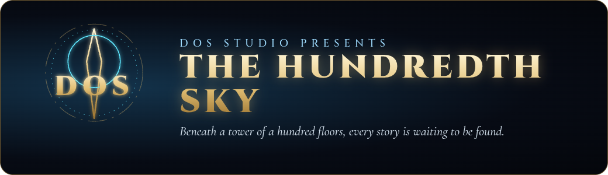
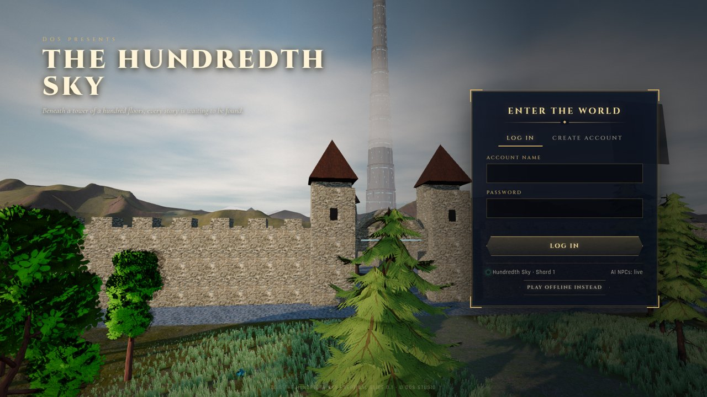
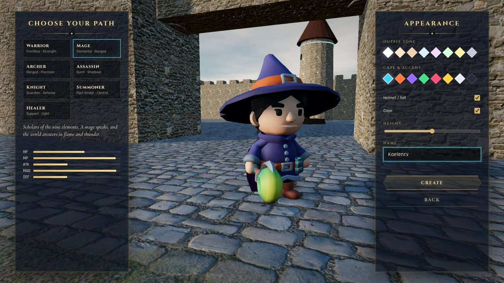
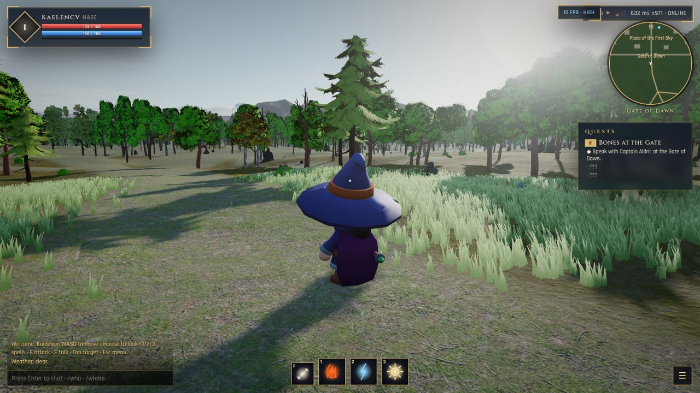
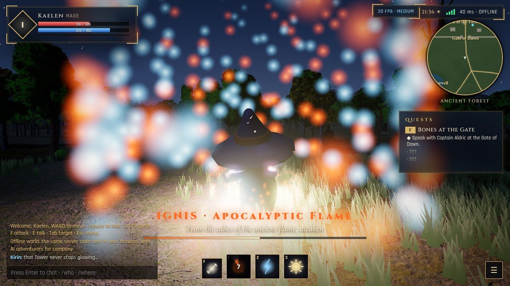
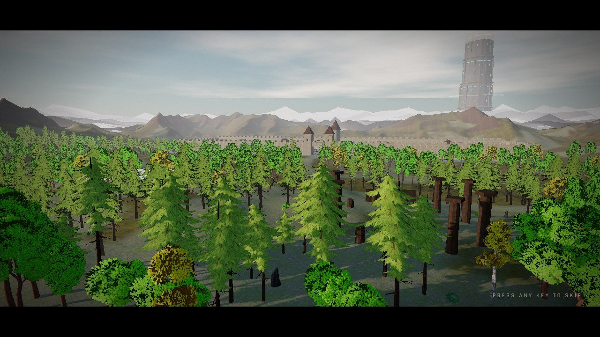
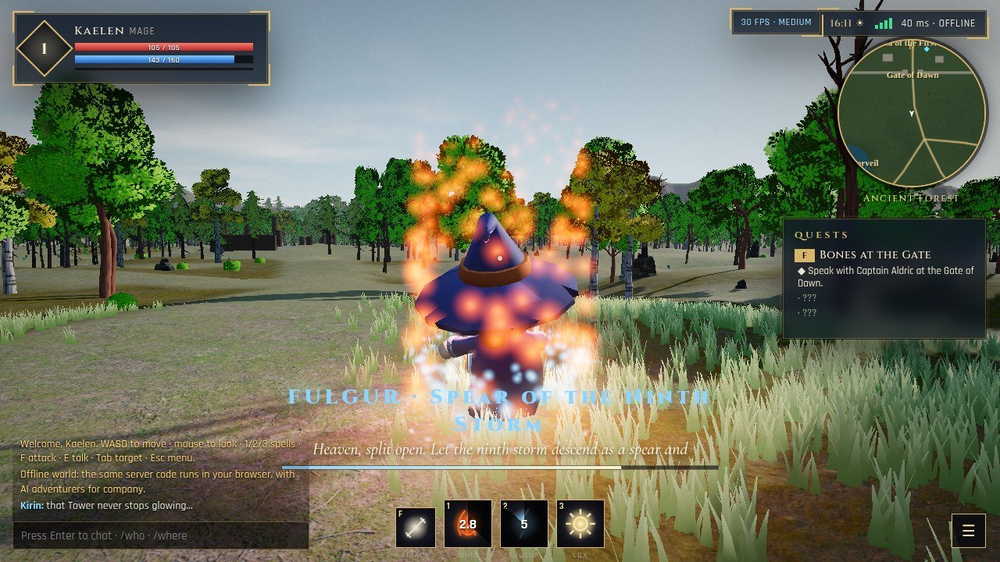
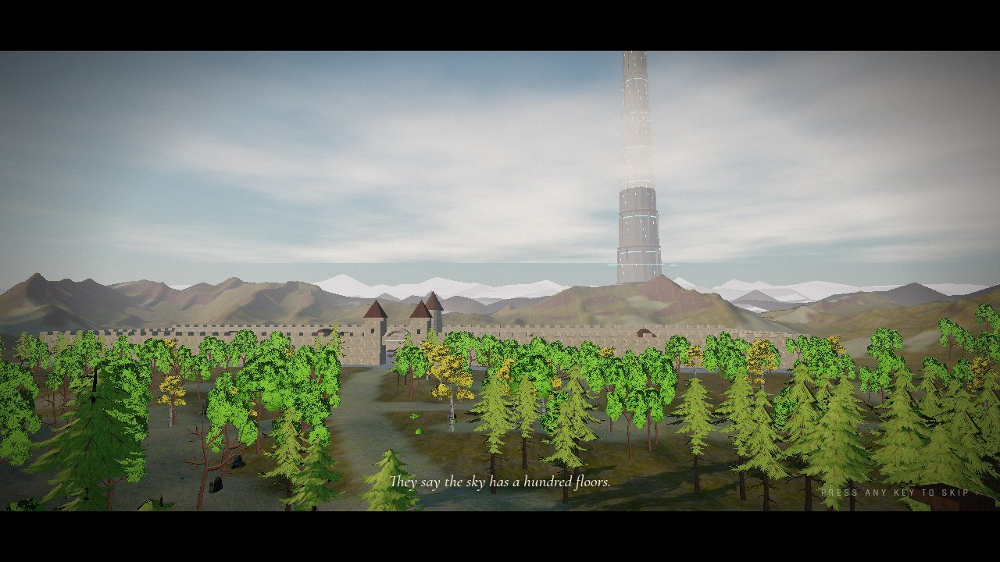
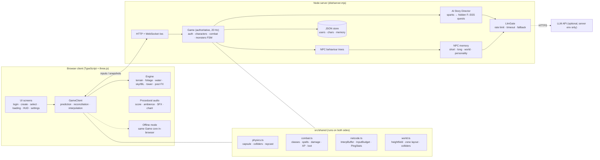

<p align="center">
  
</p>

<h3 align="center">An anime‑fantasy MMORPG vertical slice that runs in the browser</h3>

<p align="center">
  <a href="https://hundredth-sky.sites.tab.bot"><b>▶ Play in your browser</b></a> ·
  <a href="docs/media/gameplay.mp4"><b>🎬 Gameplay video (mp4)</b></a> ·
  <a href="#how-to-run">Run locally</a> ·
  <a href="#roadmap">Roadmap</a>
</p>

<p align="center">
  <a href="docs/media/gameplay.mp4"></a>
</p>

> *“They say the sky has a hundred floors. That a tower holds them up — and that no one who reached the top ever came back down.”*

**DOS: The Hundredth Sky** is the first playable slice of DOS Studio's MMORPG: the edge of the Capital and the Ancient Forest beneath the Hundredth Tower. You can log in, create a character, run through the forest with other players, and fight with spoken spells whose fire throws real light and shadow. Server-side AI NPCs remember you, and a hidden Story Director quietly writes F–SSS quests out of what you do.

| | |
|---|---|
|  |  |
|  |  |
|  |  |

---

## Live AI (server-side)

Important NPCs and the Story Director talk through any OpenAI-compatible endpoint; the live shard uses Gemini (`https://generativelanguage.googleapis.com/v1beta/openai`) with a model fallback list (`gemini-flash-latest` → `gemini-flash-lite-latest` → `gemini-3.5-flash-lite` → `gemini-3.8-flash`), retry/backoff, a resting window for overloaded models, a 10-minute reply cache and per-player + global token buckets. The key is configured only on the server: `DOS_LLM_BASE_URL` / `DOS_LLM_KEY` / `DOS_LLM_MODELS` env vars, or a `llm.secret.json` next to `server.mjs` (outside the served `client/` folder, git-ignored). With no key every NPC falls back to scripted lines and the HUD says so. `/health` shows which model answered last (never the key). Test: `node tests/e2e/ai-npc.mjs [--url …]`.

## Phase 4: the whole game

Phase 4 builds every system from the plan, milestone by milestone. See **[docs/GAME_SYSTEMS.md](docs/GAME_SYSTEMS.md)** for what each milestone added, and **[docs/STORY_PROLOGUE.md](docs/STORY_PROLOGUE.md)** for the reincarnation prologue (New Game: an ordinary life ends → the void → the Goddess Aurelia → Unique Skill, class, elemental affinity incl. the Forbidden path → Status window → wake in the Capital), Skill Fusion, the F→SSS adventurer rank and the stakes of falling.

## Features

**Cinematic entry, built like a real client**
- A logo reveal, then a camera flight over the forest to the Tower with a procedural score and subtitles. It can be skipped.
- Login and register: passwords are hashed with **scrypt** on the server (PBKDF2 in offline mode), sessions resume by token, and login attempts are rate-limited.
- Character creation covers name, 7 classes (Warrior, Mage, Archer, Assassin, Knight, Summoner, Healer) and appearance (tint, accent, headgear, cape, height), all on a live 3D preview stage.
- Character select, then a loading screen with lore tips, then the world.

**World and rendering** (three.js r170, WebGL2)
- Physically based terrain with 4-layer splatting (grass, forest floor, rock, cobble) and normal and AO maps. Water has reflections, and fog is height-aware.
- A day/night cycle drives sun, moon, stars and a cloud layer. Weather moves between **clear, rain and storm**: rain particles, wet ground and lightning.
- Instanced forests use near meshes and baked **impostor** billboards for distance. GPU grass sways in the wind. Rocks, bushes and flowers fill the ground.
- **Image-based lighting** comes from a PMREM of the live sky, refreshed as the sun moves. Cascaded-quality shadows, GTAO ambient occlusion, god rays, bloom, colour grade and SMAA.
- The Hundredth Tower rises 1.9 km, with rune bands, floating halo rings and a beam of light.
- **Spells are real lights**: every fireball and lightning strike is a dynamic point light, and the strongest casts a shadow.

> Screenshots and the video were captured headless on a machine **without a GPU** (software WebGL), with Medium settings for the video and High for the stills.

**Movement and physics**
- A third-person controller with idle, walk, run, sprint, jump, fall, land and swim.
- A kinematic capsule handles step-up, a slope limit and sub-stepping, so **no tunnelling, even at 25× speed**, as the unit tests check.
- The spring-arm camera is raycast against the world and never clips into walls.
- The **same physics code runs on client and server**. The server is authoritative.

**Combat**
- A basic attack plus 3 named spells. Each has a full incantation chanted on screen word by word (and spoken by the browser voice), a cast time, mana and a cooldown:
  - **IGNIS · Apocalyptic Flame**: *“From the ashes of the ancient flame, awaken and consume all that stands before me.”*
  - **FULGUR · Spear of the Ninth Storm**: *“Heaven, split open. Let the ninth storm descend as a spear and judge my enemy.”*
  - **LUX · Sanctuary of the First Dawn**: *“Light that was before the Tower, bloom within me. Mend the faithful, blind the wicked.”*
- Monsters (Skeleton Minion, Grave Warrior, Ash Magus) run an **AI state machine**: idle, patrol, alert, chase, attack, flee and return. They react to hits and have HP and MP.
- Elemental weaknesses, crits, XP, level-ups and loot tables with rarities.

**NPCs and AI** (all server-side; the browser never sees a key)
- Guards, a smith, a merchant and a child follow **behaviour-tree routines** that change with the hour and the weather.
- Two **LLM NPCs** (Captain Aldric of the Gate and Lyra the forest scholar) have a memory model: short-term conversation, long-term facts about you, shared world memory, and a fixed personality.
- The **AI Story Director** watches for “sparks” such as a first kill at night, casting in the rain, or reaching the ruins. From them it generates hidden quest chains ranked **F to SSS**, checks them against the world, and only reveals each one when it triggers.
- LLM calls are **rate-limited** (a global bucket plus one per player), time-boxed at 9 s, and **always have a non-LLM fallback** (scripted dialogue and procedural quests). The game never waits on a model.

**Multiplayer netcode**
- An authoritative Node server sends 20 Hz snapshots over WebSocket.
- Client-side **prediction plus reconciliation**: unacknowledged inputs are replayed on top of server state. Other players are drawn with **snapshot interpolation** (110 ms) and capped extrapolation.
- A **ping meter** shows RTT, jitter and a quality grade. Proximity chat.
- **Anti-cheat on the server**: an input time budget (a client can't simulate faster than real time, which blocks speedhacks); all movement is re-simulated against the colliders (no wall-clip); server-side range, line-of-sight, mana and cooldown checks for every attack and spell.
- Scripted bot clients (`tests/e2e/bots.mjs`) and in-world bots for testing.

**Quality and settings**
- Presets **Low, Medium, High and Ultra**, plus render scale, FOV, audio mixer (master, music, SFX, voice) and fully **rebindable keys**. Settings are saved locally.
- An offline mode runs the *same* server code inside the browser, so the game also works with no server.
- WebXR (VR) support where available, and touch controls on mobile.

---

## Architecture



```
src/
  shared/   world, physics, combat, netcode, protocol, rng   ← identical on client and server
  server/   index.ts (http + ws + scrypt + store), core/{game, director, npcdefs, bt, llm}
  client/   main.ts (flow), engine/*, game/*, net/*, ui/*, audio.ts, settings.ts
tests/
  unit/     vitest: netcode, combat, physics (wall-clip), server (auth, anti-speedhack, LLM gate, director)
  e2e/      smoke.mjs (Playwright), bots.mjs (3 scripted clients), bench.mjs, capture.mjs
tools/      fbx2glb.mjs, prune.mjs (asset pipeline)
```

---

## How to run

Requirements: **Node 20+**.

```bash
npm install
npm run build          # client → dist/client, server → dist/server.mjs
npm start              # http://localhost:8787  (game + WebSocket server)
```

Development with hot reload:

```bash
npm run dev:server     # authoritative server on :8787
npm run dev            # Vite on :5173 (proxies /ws to :8787)
```

Optional server environment variables:

| Variable | Meaning |
|---|---|
| `PORT` | HTTP/WebSocket port (default 8787) |
| `DOS_DATA_DIR` | where accounts/characters/NPC memory are saved (default `./data`) |
| `DOS_BOTS` | number of in-world bot players (default 2) |
| `DOS_DEV=1` | enables `/time`, `/weather`, `/tp`, `/xp` chat commands |
| `DOS_LLM_BASE_URL`, `DOS_LLM_KEY`, `DOS_LLM_MODEL` | any OpenAI-compatible chat endpoint for the AI NPCs and the Story Director. If unset, the game uses its scripted fallbacks. |

URL flags: `?quality=low|medium|high|ultra`, `?offline=1` (no server), `?server=wss://host/ws`, `?lag=120` (simulated latency), `?skipintro=1`, `?bench=1` (a 20 s fps benchmark flythrough).

Tests:

```bash
npm test               # 25 unit tests
npm run test:e2e       # Playwright smoke: register → create → walk into wall (no pass-through) → cast IGNIS
node tests/e2e/bots.mjs ws://localhost:8787/ws 3   # 3 scripted multiplayer clients
```

The e2e scripts use `playwright-core`. Point `CHROME_PATH` at any Chrome or Chromium, or let them find a Playwright-installed browser.

---

## Controls

| Action | Key |
|---|---|
| Move / strafe | `W` `A` `S` `D` |
| Look | mouse (click the game to lock the pointer), or right-drag |
| Jump · Sprint · Walk toggle | `Space` · `Shift` · `C` |
| Basic attack | `F` or left click |
| IGNIS · FULGUR · LUX | `1` · `2` · `3` |
| Cycle target | `Tab` |
| Talk / interact | `E` |
| Chat | `Enter` |
| Skills 1–4 · advanced · ultimate | `1`–`4` · `5` · `R` |
| Dodge roll · Parry | `Q` · `V` |
| Hero panel · Status window & Skill Fusion · Rankings | `P` · `U` · `L` |
| Fusion skills | `G` · `H` · `N` |
| Inventory · Armory · World map | `I` · `K` · `M` |
| Quest log | `J` |
| Menu / settings | `Esc` |

Every key can be rebound in **Settings → Controls**. On touch devices you get a virtual stick and buttons.

---

## Verified

| Check | Result |
|---|---|
| `npm test` (vitest) | **25/25 pass**: netcode, combat, physics (wall-clip and anti-tunnelling), server auth, anti-speedhack, LLM gate, Story Director |
| `npm run test:e2e` (Playwright, local and against the live URL) | **SMOKE PASS**: register → create → sprint into the wall (stopped at z = −87.98, wall plane −90) → IGNIS cast accepted → 0 console errors |
| `bots.mjs` on the live shard (`wss://hundredth-sky.sites.tab.bot/ws`) | **MULTIPLAYER OK**: 3 clients, each saw the other 2, average RTT about 23 ms |
| LLM NPC (local, OpenAI-compatible endpoint) | Captain Aldric answered in character (`source: llm`). The live shard currently runs the scripted fallback (#7). |

---

## Performance

Open the game with `?bench=1&quality=high` to run a 20 s fixed flythrough. It reports average fps, the 1% low and the GPU it ran on.

This slice was built and tested on a machine **without a GPU**, where WebGL2 runs through SwiftShader on the CPU. Those numbers say nothing about real hardware, so no desktop fps figure is claimed here. Run `?bench=1` on your desktop and the result is the real figure.

---

## Roadmap

From the *DOS: The Hundredth Sky Game Design Document v0.2*, §15. The roadmap is milestone-based, not tied to dates.

| Phase | Name | Status in this slice |
|---|---|---|
| 1 | Pre-production foundation | ✅ repo, build and test conventions, art direction from references |
| 2 | Playable prototype: controller, camera, weapon, enemy, health | ✅ |
| 3 | Multiplayer foundation: dedicated server, replication, server-side combat validation, persistence | ✅ (JSON store; a real database comes next) |
| 4 | RPG vertical slice: region, town hub, NPC, branching quest, inventory, dungeon and boss | 🟡 region, hub edge, NPCs, generated quests and loot are done; the dungeon, boss and equipment UI are next |
| 5 | Online social systems: party, guild, chat, trading, moderation | 🟡 chat only |
| 6 | Living world and NPC intelligence: schedules, relationships, AI dialogue, memory, fallbacks | 🟡 schedules, memory, AI dialogue and fallbacks are done; relationship states are next |
| 7 | Tower content pipeline: floor template, encounters, bosses, floor progression | ⬜ |
| 8 | Alpha, beta, release preparation | ⬜ |

**Next phase:** the first Tower floor (an instanced dungeon with a boss), parties, equipment and inventory UI, a real database (Postgres) with horizontal shard servers, and hand-authored hero characters to replace the stylised CC0 placeholders.

---

## Credits

All third-party assets are free and licence-clean (mostly CC0). See **[CREDITS.md](CREDITS.md)** for every asset and its licence.
Music, ambience and sound effects are synthesised live in WebAudio, so there are no audio files.

© 2026 Omkar Supe / DOS Studio. *The Hundredth Sky*, its world, characters and lore are the property of DOS Studio. See [LICENSE](LICENSE).

## Phase 2 — realism upgrade

- **Sky-castle login**: a real-time 3D floating castle (glowing ring bands, rotating gold halos, crystals, waterfalls, drifting islands), HDRI sky, haze, god rays, bloom and ACES tone mapping, two adventurers on the cliff, and a frosted-glass panel with email/password login.
- **Realistic heroes**: CC0 rigged human bodies (masculine/feminine, per-class outfits) with idle, walk, jog, sprint, jump, attack, cast and death animations. Playback rate follows ground speed (gait measured from the clips), so feet don't slide.
- **Legendary weapons**: Frostfang, Ignis, Umbra Twins, Aether Orb Staff, Sol Aurelia and Skyreach, built as PBR models with emissive runes and particle auras. The equipped weapon is drawn in the hero's hand and is visible to other players.
- **Armory (K)**: a showcase on a dark reflective cobblestone floor, with seams glowing in the rarity colour, sparkles, a lineup view and drag-to-rotate.
- **Inventory & equipment (I)**: 8 equipment slots and a bag. Equip and unequip are server-authoritative: ownership and class are checked and stat bonuses are applied. Legendaries can drop from Tower monsters.
- **Spell VFX**: GPU-simulated particles. IGNIS is a fireball with an explosion, smoke and a shockwave; FULGUR is branching tube lightning; LUX is a column of dawn light. Particle budgets scale with the quality tier (Low for phones).
- **Dev harness**: `dev.html?scene=skycastle|armory|hero` renders the new scenes on their own (`tests/e2e/still.mjs`).

## Phase 3 — title menu, golden-hour look, fast loading

- **Title / main menu** (`src/client/ui/menu.ts`, `src/client/scenes/skycastle.ts`): golden-hour sea of clouds, floating castle, hero from behind in a wind-blown cloth cloak. Continue resumes the last hero, New Game opens character creation, Settings opens options, Quit logs out. Works in phone portrait and desktop landscape; keyboard navigable.
- **Look**: warm golden grade in sky/post, finer meadow grass, cloth cloaks on heroes (`engine/cloak.ts`), HUD restyled in ivory-gold glass with heart/lightning bars, the violet twin blades are true crescents.
- **Loading**: the menu shows at once over a 80 KB poster while the 3D title and then the world stream in the background. Animations slimmed (anims_skel 2.7 MB → 0.33 MB), unused models removed, textures WebP, title uses 512 px textures, and the server serves pre-compressed `.br/.gz` twins (`tools/precompress.mjs`, run by `npm run build`) with immutable caching for hashed bundles.
  Measured with `npm run test:load` (cold cache, 9 Mbps / 150 ms): world ready 24.3 s / 16.4 MB → 16.7 s / 6.4 MB; first interactive screen 11 s → 1.6 s; live 3D title 4.3 s. Slow 4G (1.6 Mbps): first screen 36 s → 3.3 s, world 92 s → 41 s.
- **Tests**: `npm test` (unit), `npm run test:menu` (menu flow: settings, New Game → register → create → world, reload → Continue, Quit), `node tests/e2e/smoke.mjs`, `node tests/e2e/bots.mjs <ws> 3`.
